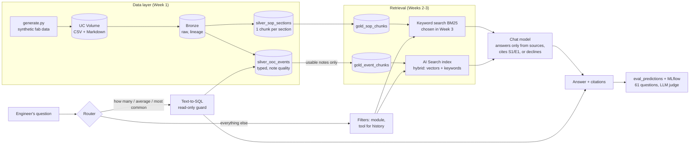

# Fab Troubleshooting Assistant (RAG on Databricks)

**An assistant that answers "this tool just went out of control, what do I check?" by retrieving the right SOP and the past OOC cases that were fixed the same way, and citing both.**

> **Status: Weeks 1 to 3 complete.** On its evaluation set, the assistant ranks the right SOP first **97.5%** of the time, always retrieves the release criteria, declines **every** out-of-scope question, and its answers cover **94.6%** of the expected points with **80.4%** fully grounded in the sources (LLM judge). Every number comes from synthetic data; see [Week 3 results](#week-3-results).

When an SPC chart goes out of control on the fab floor, the fix is usually already known: it sits in an SOP, or in a closure note someone wrote six months ago on the same tool. The problem is finding it. Closure notes are free text full of shorthand, searched by keyword if at all, and around 1 in 10 says nothing useful ("fixed", "see shift log"). Engineers lose time, and the same root cause gets rediscovered from scratch.

This project is a retrieval-augmented (RAG) assistant over two sources:

1. **SOPs**: 23 troubleshooting and response procedures, split into section-level chunks.
2. **Past OOC events**: 450 SPC out-of-control events with engineer closure notes, so the assistant can say *"ETCH-03 had this twice before; both times it was the He seal o-ring."*

> **All data is synthetic.** The fab ("Northbridge Fab 1"), tool platforms, tool IDs, limits and procedures are invented. They follow how front-end fabs generally run SPC and troubleshooting, but they do not reproduce any company's documents, recipes or data.

---

## Before vs After

| | Current state (manual) | Future state (this assistant, measured) |
|---|---|---|
| Finding the right SOP | Browse the SOP index | Retrieved from the symptom: right SOP ranked first **97.5%**, in the top 4 **100%** |
| Release criteria for the fix | Look them up separately | Always included: **100%** of troubleshooting answers had the acceptance criteria retrieved |
| Finding a past fix on the same tool | Keyword search or asking around; often not found | History questions found **100%** of past events on that tool, with fixes summarised |
| Vague closure notes ("fixed") | Mixed in with useful ones | Flagged in Silver and **excluded from the index** (10.2% of notes) |
| Questions it can't support | n/a | **Declined 6 of 6**; only 1 of 40 answerable questions wrongly declined |
| Counting questions ("how many OOCs on CMP-02 in Q2?") | Manual query | Routed to SQL: **3 of 3** correct |

The assistant is decision support: it shortens the search, and the engineer still decides and signs off the tool release.

---

## Architecture



---

## The dataset (Week 1)

Generated by `src/fabrag/generate.py` (standard library only, fixed seed, fully reproducible: CI regenerates it and fails if the committed files differ).

| File | Rows | What it contains |
|---|---|---|
| `data/raw/ooc_events.csv` | 450 | OOC events, Jan 2025 to Sep 2026: tool, chamber, parameter, value, SPC rule, lot, engineer, root cause code, **closure note**, downtime |
| `data/raw/maintenance_logs.csv` | 718 | Monthly PMs plus unscheduled repairs linked to OOC events, with parts replaced |
| `data/raw/tools.csv` | 20 | 5 modules: Etch (6 tools), CVD (4), CMP (4), Lithography (3), Wet clean (3) |
| `data/raw/root_causes.csv` | 22 | Root cause taxonomy, each mapped to an SOP |
| `data/sops/*.md` | 23 | SOP library: purpose, symptoms, safety, checks, corrective procedure, acceptance criteria, parts, escalation |
| `data/eval/eval_questions.jsonl` | 61 | Evaluation set with ground truth (below) |
| `data/ground_truth/ooc_ground_truth.csv` | 450 | True root cause per event. **Never indexed**: used only to score the assistant |

**Realistic messiness is built in on purpose:**
- Closure notes vary in style and use fab shorthand (`repl`, `wfrs`, `requal'd`, `RFh`), and about 1 in 5 is written all in lower case.
- **10.2%** of notes are too vague to be useful ("fixed", "tool back up", "see shift log").
- **18.0%** of events have no root cause code entered.
- **~10%** of OOCs are metrology false alarms, where the right answer is *"re-measure before touching the tool."*

Example closure notes:

> `CD uniformity (3-sigma) OOC on ETCH-01-C (Rule 5), value 2.46 nm. CDU degrading, edge ER high vs centre, ring eroded on inspection. Repl edge ring + screws, requal'd CDU and ER on 3 mons. Lot L2594058 released.`
>
> `thickness uniformity (1-sigma) ooc on cvd-03-a (rule 4), value 1.45 %. line heater zone 3 reading low, condensation suspected. replaced line heater jacket, flow stable, mons pass. lot l2523168 released.`

## How the assistant answers (Week 2)

`src/fabrag/assistant.py`, wired to Databricks in `notebooks/03_assistant.py`:

1. **Route.** Counting questions ("how many", "average", "most common") go to **SQL**: an LLM writes one query, a guard allows only a single `SELECT` on `silver_ooc_events` (no writes, no other tables, never the ground truth), and Spark runs it. Everything else goes to retrieval.
2. **Filter.** A tool ID in the question (`ETCH-04`) restricts SOPs to that module plus the general SOPs, and events to that module. History questions ("has ETCH-03 had this before?") filter events to that exact tool.
3. **Retrieve.** Top 4 SOP sections and top 5 past events (10 for history questions). *(Week 3, chosen from the evaluation)* SOPs come from **keyword search (BM25)**, past events from **AI Search hybrid search** (vectors plus keywords), and **parent-document expansion** always adds the top SOP's Checks, Procedure and Acceptance criteria sections, so release limits are never missing.
4. **Answer.** The chat model (default `databricks-gpt-oss-120b`) answers **only from the numbered sources**, cites them as `[S1]` / `[E2]`, uses a fixed structure (likely cause, checks, fix, release criteria, similar past events), and must reply *"I can't answer that from the knowledge base"* when the sources don't cover the question.

Example question: *"Getting helium flow alarms on ETCH-04 and a few de-chuck errors. What should I check first?"* The answer should name the ESC helium leak, the leak-up test above 1.5 sccm, the o-ring fix and the 1.0 sccm release limit, citing SOP-ETCH-003 and past events.

## Results: first run (Week 2)

Scored on the 49-question set by `src/fabrag/evaluate.py`, Databricks Free Edition, `databricks-gpt-oss-120b`, 0 errors. Ground truth is used **only** for scoring.

| Metric | BM25 keyword baseline | AI Search hybrid |
|---|---|---|
| Routing accuracy (SQL vs retrieval) | 100% | **100%** |
| Right SOP in top 4 | 100% | 97.5% |
| Right SOP ranked first | 95% | 92.5% |
| Past events with the correct root cause (precision at 5) | 75.0% | **79.3%** |
| History questions: past events on that tool found | **93.8%** | 83.8% |
| Out-of-scope questions declined (6) | n/a | **100%** |
| Answerable questions wrongly declined (40) | n/a | 7.5% (3) |
| Counting questions answered correctly via SQL (3) | n/a | **3 of 3** (one returned the root cause name instead of the code) |

**What the first run showed:**
- **Safety behaviour works.** Every out-of-scope question was declined, every counting question went to SQL, and answers cite their sources.
- **Hybrid search did not beat keyword search yet.** It improved past-event precision (75% to 79%) but was slightly worse on SOP ranking and history recall. The questions share distinctive words with the SOPs, so keyword search is already near its ceiling; meaning-based search isn't being tested.
- **Error analysis of the 3 "false declines"** found one cause: the *Acceptance criteria* section of the right SOP was not retrieved, because low-value sections (Purpose, Scope) took the slots. The prompt then made the model refuse the whole answer for one missing part. The SOP-level metric also counted one of these as a hit, because the right document was found but not the right section.

## Week 3: fixes from the error analysis, and a stricter evaluation

| Change | Why (from the Week 2 run) |
|---|---|
| **Parent-document expansion**: the top SOP's sections 5 to 7 are always included | Release criteria (section 7) were missing in 2 of the 3 false declines |
| **Low-value sections removed from the index** (Purpose, Scope, Related documents): 247 to 180 chunks | They took retrieval slots from Checks, Procedure and Acceptance |
| **Partial answers allowed**: decline only when the main question is unanswerable | The model refused a whole correct answer for one missing detail |
| **Citations normalised** (`【S1】` and `(S1)` become `[S1]`) | gpt-oss cited in CJK brackets, so citations went uncounted |
| **Optional reranker** (Databricks reranker on AI Search results) | Loosely related events took history slots. *Not available on Free Edition, so not measured* |
| **Section-level scoring**: procedure questions name the section that holds the answer | One "hit" in Week 2 found the right SOP but not the right section |
| **12 paraphrased questions** that avoid the SOP's vocabulary ("wafer doesn't stay clamped" for a helium leak) | Week 2 questions shared keywords with the SOPs, so they could not show what meaning-based search adds |
| **LLM judge**: coverage of the expected points, and groundedness in the sources | Retrieval metrics alone don't say whether the written answer is right |
| **SQL grading accepts a root cause code or its name** | One correct SQL answer was marked wrong |

**Offline check (BM25 keyword baseline, no Databricks):** the paraphrased questions are clearly harder. Right SOP ranked first drops from 97.5% (original questions) to 83%, and past-event precision from 75% to 45%. Parent-document expansion raises "release criteria retrieved" from 46% to 100%. `notebooks/04_evaluate.py` runs the same comparison on AI Search (vector, hybrid, hybrid + reranker, each with and without expansion), then the full assistant with the LLM judge, and prints a **Before vs After** table against the Week 2 run.

### Week 3 results

Databricks Free Edition, `databricks-gpt-oss-120b` for answers and as the judge, 61 questions, 0 errors.

**1. Which retrieval setting? (section 1 of `04_evaluate`, no chat model)**

| | BM25 keyword | Vector only | AI hybrid | AI hybrid + expand | BM25 + expand | **Split + expand** (chosen) |
|---|---|---|---|---|---|---|
| Right SOP ranked first | 97.5% | 90.0% | 90.0% | 90.0% | 97.5% | **97.5%** |
| ...on paraphrased questions | 83.3% | 58.3% | 58.3% | 58.3% | 83.3% | **83.3%** |
| Release criteria retrieved | 45.5% | 22.7% | 45.5% | 90.9% | 100% | **100%** |
| Past events with the right root cause | 67.9% | 70.0% | 74.3% | 74.3% | 67.9% | **74.3%** |

The finding I didn't expect: **keyword search beat AI search at ranking SOPs**, even on questions reworded to avoid the SOP's vocabulary. SOPs share a fixed equipment vocabulary, while closure notes are free text, where meaning-based search does better. So the final setting, `split_expand`, uses each where it wins: BM25 for SOPs, hybrid for past events, plus parent-document expansion. Expansion alone took "release criteria retrieved" from 45% to 100%.

**2. Before vs After (same 49 questions as Week 2)**

| Metric | Week 2 | Week 3 | |
|---|---|---|---|
| Right SOP ranked first | 92.5% | **97.5%** | ✅ |
| History: past events on that tool found | 83.8% | **100%** | ✅ |
| Answerable questions wrongly declined | 7.5% (3) | **2.5% (1)** | ✅ |
| Release criteria retrieved (troubleshooting) | not measured | **100%** | ✅ |
| Out-of-scope questions declined | 100% | 100% | held |
| Routing and SQL answers | 100%, 3 of 3 | 100%, 3 of 3 | held |
| Past events with the right root cause | 79.3% | 74.3% | ⚠️ trade-off: history questions now fetch 10 events, so more are off-topic |

**3. Is the written answer right? (LLM judge, all answered questions)**

| | Score |
|---|---|
| Expected points covered | **94.6%** (troubleshooting 100%, history 100%, paraphrase 93.3%, procedure 83.3%) |
| Answers with every claim supported by the sources (groundedness) | **80.4%** |
| Judge failures | 0 |

**How groundedness went from 63.5% to 80.4%, and what I learned about evaluating the judge:**
1. **The judge failed silently at first.** With an 800-token limit, the reasoning model ran out of tokens before writing its verdict, so 9 of 10 answers had no score. Fixed with a larger budget, a parser that recovers cut-off replies, and a re-grade step that scores saved answers without regenerating them.
2. **First real score: 63.5%.** I read every flagged answer instead of trusting the number. Three causes:
   - *The judge was wrong:* it hadn't been told the fab's standing rules ("release needs engineer sign-off"), so it marked them as unsupported. The judge now sees the same policy text as the assistant.
   - *The assistant misapplied a rule:* "verify the measurement first" is for a single odd reading, but it was added to trends and alarms. The rule is now scoped.
   - *The assistant filled gaps from general knowledge* when retrieval returned the wrong SOP, including release criteria from an unrelated SOP. This is the dangerous one in a fab. The prompt now forbids it, and the split retrieval removes most of the wrong-SOP cases.
3. **Result: 76.9%, then 80.4%** with the split retrieval.

**What still goes wrong (12 of 52 judged answers flagged):**
- Mostly small extra claims, such as "cleaned twice" stated for every past event when only some notes say so, or "no similar past events" when the sources are simply silent.
- **One wrong-module retrieval:** *"How cool does a CVD chamber need to be before a heater replacement?"* got an etch SOP, because the question names the module but no tool ID. Fixed after the run by recognising module and platform names (CVD, CMP, Kestrel K9 and so on); offline, procedure section hits went from 91.7% to 100% with nothing else changing. Not yet re-measured on Databricks.
- **One over-cautious decline:** *"Who is allowed to replace the ESC?"*. The retrieved procedure says "escalate for ESC replacement with the vendor", but the model wanted an explicit statement. Left as is: the prompt is deliberately strict, and a decline is safer than an invented answer.
- The judge is itself an LLM, so its flags need spot checks; about half of the remaining ones are judgement calls.

Median time per question was about 30 s, which includes the answer and the judge call; answering alone is roughly half of that.


## The evaluation set

Questions are written the way an engineer on shift asks them, **not** with the SOP's wording, so retrieval has to match meaning rather than copied keywords.

| Type | Count | Example | What a good answer does |
|---|---|---|---|
| Troubleshooting | 22 | *"Getting helium flow alarms on ETCH-04 and a few de-chuck errors. What should I check first?"* | Names the likely cause, the checks, the fix and the acceptance criteria; cites the SOP and similar past events |
| Procedure lookup | 12 | *"What leak-up rate is acceptable after replacing a focus ring?"* | Returns the exact value from the right SOP section |
| History | 6 | *"Has ETCH-03 had a helium backside leak before, and what fixed it?"* | Finds the specific past events and summarises their fixes |
| Aggregate | 3 | *"How many OOC events did CMP-02 have in Q2 2025?"* | Routes to SQL (reference query included) instead of guessing from text |
| Unanswerable | 6 | *"How do I tune beam current on the ion implanter?"* | Says the knowledge base doesn't cover it |
| Paraphrase *(Week 3)* | 12 | *"On ETCH-01 the wafer doesn't stay clamped properly and the backside cooling keeps alarming."* | Same as troubleshooting, but with none of the SOP's own words |

Each question carries its expected SOP IDs, relevant event IDs and the answer points a correct response must contain, so Week 3 can score **retrieval** (did it fetch the right chunks?) separately from **generation** (is the answer correct and grounded in them?).

---

## Run it

**Locally (tests):**
```bash
pip install -r requirements-dev.txt     # pytest + pyspark (needs Java 17+)
pytest -q                               # 48 tests: data, DQ rules, chunking, routing, SQL guard, assistant, judge
PYTHONPATH=src python -m fabrag.generate --out data   # regenerate the dataset
```

**On Databricks (tested on Free Edition):**
1. Add this repo as a Git folder in your workspace.
2. Create a Volume, for example `workspace.fab_rag.raw`, and upload the repo's `data/` folder into it.
3. Run `notebooks/01_bronze_silver.py`: Bronze and Silver tables plus the DQ scorecard.
4. Create an AI Search endpoint (Compute → AI Search → Create endpoint, Standard), for example `fab-rag-endpoint`.
5. Run `notebooks/02_build_index.py`: Gold tables and two Delta Sync indexes with managed `databricks-gte-large-en` embeddings.
6. Run `notebooks/03_assistant.py` to ask the assistant questions.
7. Run `notebooks/04_evaluate.py`: compare retrieval settings, run the full evaluation with the LLM judge, log everything to MLflow, and compare with earlier runs.

---

## Design decisions

- **Chunk SOPs by section, not by fixed token count.** Each `## ` section (checks, procedure, acceptance criteria) is a complete unit of meaning, so a chunk never cuts an acceptance criterion in half. Each chunk is prefixed with the SOP ID and title so it still makes sense on its own.
- **Index OOC events as one row each**, with a `retrieval_text` that combines tool, symptom, root cause and closure note. A past event is only useful as a whole story.
- **Filter vague notes before indexing.** "fixed" matches nothing useful and dilutes retrieval. The note-quality rule is tested against ground truth: it catches every vague note and nothing else.
- **Keep ground truth out of the knowledge base.** The engineer-entered root cause code is indexed (it's real-world data); the true label is held back for scoring only.
- **Counting questions go to SQL.** Retrieval returns the top few chunks; it cannot count 450 events. The eval set checks that the assistant routes these instead of answering confidently and wrongly.
- **No Python UDFs in Silver**, so the same transforms run on serverless compute and in local tests.
- **Keyword search for SOPs, hybrid search for past events.** Chosen from measurement, not assumed: on this corpus BM25 ranked SOPs better than AI Search (97.5% vs 90% first), while hybrid found better past events (74% vs 68%). Fab text is full of exact identifiers (tool IDs, root cause codes, parameter names) that pure embeddings blur together.
- **Evaluate the evaluator.** Every judge flag in the first run was read by hand, which found a silent judge failure and a judge that didn't know the fab's rules, before any change was made to the assistant.
- **Backends are injected.** The assistant takes `search_fn`, `llm_fn` and `sql_fn` as plain functions, so the same code runs on Databricks and in offline tests with a BM25 index and a fake LLM.
- **Gold tables are MERGEd, not overwritten**, so re-running only re-embeds rows that changed.

## Roadmap

- [x] **Week 1:** synthetic dataset, SOP library, evaluation set, Bronze/Silver tables, DQ scorecard, tests, CI
- [x] **Week 2:** Gold tables, AI Search hybrid indexes with managed embeddings, assistant with citations, SQL routing with a read-only guard, retrieval metrics against a BM25 baseline
- [x] **Week 3:** fixes from error analysis, parent-document expansion, paraphrased questions, LLM judge (and fixing the judge), split retrieval chosen from the evaluation, MLflow tracking, Before vs After
- [ ] **Next:** chat UI as a Databricks App

## Limitations

- Synthetic data is cleaner than reality: real closure notes mix languages, reference people and lots, and contain typos this generator only partly imitates.
- 22 root causes is a small taxonomy; a real fab has hundreds, with overlapping symptoms.
- The assistant is decision support. Tool release still requires the acceptance criteria in the SOP and an engineer's sign-off.
- BM25 for SOPs runs in memory over the repo's SOP files: fine for 180 chunks. At scale it would move to a search service, or AI Search with a tuned keyword weight.
- The reranker could not be tested on Free Edition, and the judge uses the same model family as the assistant, which can make it lenient on that model's style.

## Repo structure

```
src/fabrag/
  knowledge.py     fictional fab: modules, tools, SPC parameters, 22 root causes
  sops.py          renders the SOP library as Markdown
  eval_spec.py     hand-written evaluation questions and answer points
  generate.py      builds the dataset (python -m fabrag.generate)
  silver.py        Bronze -> Silver PySpark transforms and DQ scorecard
  gold.py          Silver -> Gold: the tables the indexes sync from
  assistant.py     routing, filters, prompt, SQL guard, citations
  baseline.py      BM25 keyword baseline (and offline search for tests)
  evaluate.py      routing, retrieval, section-level and decline metrics
  judge.py         LLM judge: answer coverage and groundedness
  backends.py      Databricks AI Search, model serving and SQL wiring
notebooks/
  01_bronze_silver.py   Volume -> Bronze -> Silver
  02_build_index.py     Gold tables + AI Search indexes
  03_assistant.py       ask the assistant questions
  04_evaluate.py        compare retrieval settings, LLM judge, MLflow, Before vs After
data/                   generated dataset (committed, reproducible)
tests/                  generator, Silver/Gold and assistant tests
```
