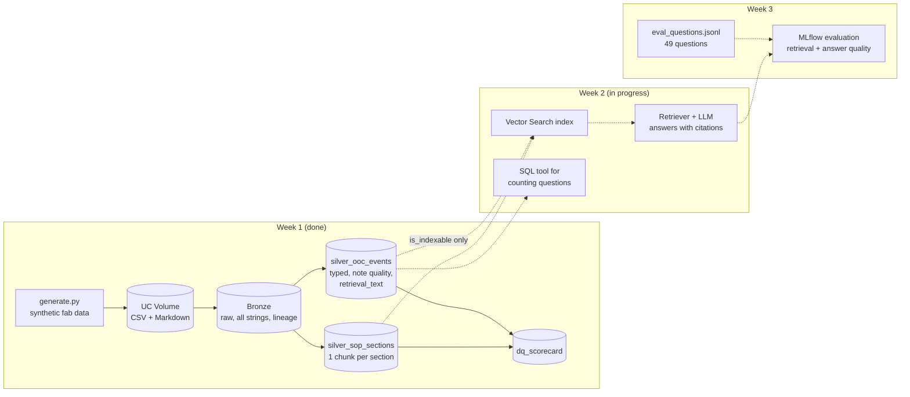

# Fab Troubleshooting Assistant (RAG on Databricks)

**An assistant that answers "this tool just went out of control, what do I check?" by retrieving the right SOP and the past OOC cases that were fixed the same way, and citing both.**

> **Status: Week 1 of 3 complete** (dataset, Bronze/Silver tables, evaluation set). Retrieval and generation (Week 2) and evaluation results (Week 3) are in progress. Every number below comes from the synthetic data and is labelled as such.

When an SPC chart goes out of control on the fab floor, the fix is usually already known: it sits in an SOP, or in a closure note someone wrote six months ago on the same tool. The problem is finding it. Closure notes are free text full of shorthand, searched by keyword if at all, and around 1 in 10 says nothing useful ("fixed", "see shift log"). Engineers lose time, and the same root cause gets rediscovered from scratch.

This project builds the data layer and evaluation harness for a retrieval-augmented assistant over two sources:

1. **SOPs**: 23 troubleshooting and response procedures, split into section-level chunks.
2. **Past OOC events**: 450 SPC out-of-control events with engineer closure notes, so the assistant can say *"ETCH-03 had this twice before; both times it was the He seal o-ring."*

> **All data is synthetic.** The fab ("Northbridge Fab 1"), tool platforms, tool IDs, limits and procedures are invented. They follow how front-end fabs generally run SPC and troubleshooting, but they do not reproduce any company's documents, recipes or data.

---

## Before vs After (target state, to be measured in Week 3)

| | Current state | Target state |
|---|---|---|
| Finding a past fix for the same symptom | Keyword search or asking around; often not found | Semantic search across all closure notes, with the matching events cited |
| Finding the right SOP | Browse the SOP index | Retrieved from the symptom description |
| Vague closure notes ("fixed") | Mixed in with useful ones | Flagged in Silver and **excluded from the index** |
| Answers to questions it can't support | n/a | **Declines** instead of guessing, measured on 6 out-of-scope questions |
| Counting questions ("how many OOCs on CMP-02 in Q2?") | Manual | Routed to SQL, not answered from retrieved text |

---

## Architecture



---

## The dataset (Week 1)

Generated by `src/fabrag/generate.py` (standard library only, fixed seed, fully reproducible: CI regenerates it and fails if the committed files differ).

| File | Rows | What it contains |
|---|---|---|
| `data/raw/ooc_events.csv` | 450 | OOC events, Jan 2025 to Sep 2026: tool, chamber, parameter, value, SPC rule, lot, engineer, root cause code, **closure note**, downtime |
| `data/raw/maintenance_logs.csv` | 718 | Monthly PMs plus unscheduled repairs linked to OOC events, with parts replaced |
| `data/raw/tools.csv` | 20 | 5 modules: Etch (6 tools), CVD (4), CMP (4), Lithography (3), Wet clean (3) |
| `data/raw/root_causes.csv` | 22 | Root cause taxonomy, each mapped to an SOP |
| `data/sops/*.md` | 23 | SOP library: purpose, symptoms, safety, checks, corrective procedure, acceptance criteria, parts, escalation |
| `data/eval/eval_questions.jsonl` | 49 | Evaluation set with ground truth (below) |
| `data/ground_truth/ooc_ground_truth.csv` | 450 | True root cause per event. **Never indexed**: used only to score the assistant |

**Realistic messiness is built in on purpose:**
- Closure notes vary in style and use fab shorthand (`repl`, `wfrs`, `requal'd`, `RFh`), and about 1 in 5 is written all in lower case.
- **10.2%** of notes are too vague to be useful ("fixed", "tool back up", "see shift log").
- **18.0%** of events have no root cause code entered.
- **~10%** of OOCs are metrology false alarms, where the right answer is *"re-measure before touching the tool."*

Example closure notes:

> `CD uniformity (3-sigma) OOC on ETCH-01-C (Rule 5), value 2.46 nm. CDU degrading, edge ER high vs centre, ring eroded on inspection. Repl edge ring + screws, requal'd CDU and ER on 3 mons. Lot L2594058 released.`
>
> `thickness uniformity (1-sigma) ooc on cvd-03-a (rule 4), value 1.45 %. line heater zone 3 reading low, condensation suspected. replaced line heater jacket, flow stable, mons pass. lot l2523168 released.`

## The evaluation set

Questions are written the way an engineer on shift asks them, **not** with the SOP's wording, so retrieval has to match meaning rather than copied keywords.

| Type | Count | Example | What a good answer does |
|---|---|---|---|
| Troubleshooting | 22 | *"Getting helium flow alarms on ETCH-04 and a few de-chuck errors. What should I check first?"* | Names the likely cause, the checks, the fix and the acceptance criteria; cites the SOP and similar past events |
| Procedure lookup | 12 | *"What leak-up rate is acceptable after replacing a focus ring?"* | Returns the exact value from the right SOP section |
| History | 6 | *"Has ETCH-03 had a helium backside leak before, and what fixed it?"* | Finds the specific past events and summarises their fixes |
| Aggregate | 3 | *"How many OOC events did CMP-02 have in Q2 2025?"* | Routes to SQL (reference query included) instead of guessing from text |
| Unanswerable | 6 | *"How do I tune beam current on the ion implanter?"* | Says the knowledge base doesn't cover it |

Each question carries its expected SOP IDs, relevant event IDs and the answer points a correct response must contain, so Week 3 can score **retrieval** (did it fetch the right chunks?) separately from **generation** (is the answer correct and grounded in them?).

---

## Run it

**Locally (tests):**
```bash
pip install -r requirements-dev.txt     # pytest + pyspark (needs Java 17+)
pytest -q                               # 11 tests: integrity, reproducibility, DQ rules, chunking
PYTHONPATH=src python -m fabrag.generate --out data   # regenerate the dataset
```

**On Databricks (Week 1 needs only notebooks, a Volume and Delta tables, which Free Edition includes):**
1. Add this repo as a Git folder in your workspace.
2. Create a Volume, for example `workspace.fab_rag.raw`, and upload the repo's `data/` folder into it.
3. Run `notebooks/01_bronze_silver.py` (widgets: `catalog`, `schema`, `volume`). It creates the Bronze and Silver tables and the DQ scorecard, and enables Change Data Feed on the Silver tables for Vector Search.

---

## Design decisions

- **Chunk SOPs by section, not by fixed token count.** Each `## ` section (checks, procedure, acceptance criteria) is a complete unit of meaning, so a chunk never cuts an acceptance criterion in half. Each chunk is prefixed with the SOP ID and title so it still makes sense on its own.
- **Index OOC events as one row each**, with a `retrieval_text` that combines tool, symptom, root cause and closure note. A past event is only useful as a whole story.
- **Filter vague notes before indexing.** "fixed" matches nothing useful and dilutes retrieval. The note-quality rule is tested against ground truth: it catches every vague note and nothing else.
- **Keep ground truth out of the knowledge base.** The engineer-entered root cause code is indexed (it's real-world data); the true label is held back for scoring only.
- **Counting questions go to SQL.** Retrieval returns the top few chunks; it cannot count 450 events. The eval set checks that the assistant routes these instead of answering confidently and wrongly.
- **No Python UDFs in Silver**, so the same transforms run on serverless compute and in local tests.

## Roadmap

- [x] **Week 1:** synthetic dataset, SOP library, evaluation set, Bronze/Silver tables, DQ scorecard, tests, CI
- [ ] **Week 2:** embeddings and Vector Search index (fallback: Chroma/FAISS if Vector Search is not available on the workspace tier), retriever with citations, SQL routing for aggregate questions, simple chat UI
- [ ] **Week 3:** MLflow evaluation (retrieval hit rate, answer correctness, groundedness, decline rate), comparison of 2 to 3 retrieval settings, measured Before vs After

## Limitations

- Synthetic data is cleaner than reality: real closure notes mix languages, reference people and lots, and contain typos this generator only partly imitates.
- 22 root causes is a small taxonomy; a real fab has hundreds, with overlapping symptoms.
- The assistant is decision support. Tool release still requires the acceptance criteria in the SOP and an engineer's sign-off.

## Repo structure

```
src/fabrag/
  knowledge.py     fictional fab: modules, tools, SPC parameters, 22 root causes
  sops.py          renders the SOP library as Markdown
  eval_spec.py     hand-written evaluation questions and answer points
  generate.py      builds the dataset (python -m fabrag.generate)
  silver.py        Bronze -> Silver PySpark transforms and DQ scorecard
notebooks/
  01_bronze_silver.py   Databricks notebook: Volume -> Bronze -> Silver
data/                   generated dataset (committed, reproducible)
tests/                  generator and Silver tests
```
